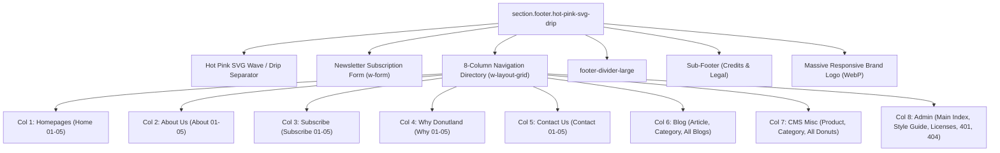

# Site Structure & Information Architecture: Donutland Webflow Template

**Target Template:** [Donutland Webflow Template](https://donutland.webflow.io/)  
**Author:** Agent 1 — Website Exploration & Information Architecture Specialist  
**Workspace:** `s:\Apps\donuts\`  
**Deliverable File:** `s:\Apps\donuts\docs\inventory\SITE_STRUCTURE.md`  
**Standard:** [Adeel Dev Standard](file:///C:/Users/Adeel%20Sayyad/.adeel-dev/standards/Adeel-Dev-Standard.md)  
**Audit Date:** September 2026  

---

## 1. Executive Summary & Information Architecture Overview

The Donutland Webflow template is a multi-archetype eCommerce and marketing powerhouse engineered specifically for food & beverage, artisanal bakeries, subscription donut clubs, and quick-serve retail concepts. Rather than presenting a single rigid layout, Donutland was architected as a **5-in-1 theme system**, offering 5 complete, distinct design expressions across its core conversion funnels (Home, About, Contact, Subscribe & Save, and Why Donutland).

This document formalizes the complete site architecture, hierarchical URL topologies, navigation mechanics, global shared component relationships, routing patterns, and downstream translation into Next.js 14+ App Router.

---

## 2. High-Level Site Architecture Diagram

```mermaid
graph TD
    ROOT["/"] --> LANDING["Core Landing Index"]
    ROOT --> HOMEPAGES["/homepages/"]
    ROOT --> ABOUT["/about-us/"]
    ROOT --> CONTACT["/contact-us/"]
    ROOT --> SUBSCRIBE["/subscribe-save/"]
    ROOT --> WHY["/why-donutland/"]
    ROOT --> DIRECTORIES["Catalog Directories"]
    ROOT --> CMS_DYNAMIC["CMS Collections"]
    ROOT --> SYSTEM["Admin & Utility"]
    ROOT --> ECOMM["E-Commerce Flow"]

    HOMEPAGES --> H1["/homepages/home-01"]
    HOMEPAGES --> H2["/homepages/home-02"]
    HOMEPAGES --> H3["/homepages/home-03"]
    HOMEPAGES --> H4["/homepages/home-04"]
    HOMEPAGES --> H5["/homepages/home-05"]

    ABOUT --> A1["/about-us/about-us-01"]
    ABOUT --> A2["/about-us/about-us-02"]
    ABOUT --> A3["/about-us/about-us-03"]
    ABOUT --> A4["/about-us/about-us-04"]
    ABOUT --> A5["/about-us/about-us-05"]

    CONTACT --> C1["/contact-us/contact-us-01"]
    CONTACT --> C2["/contact-us/contact-us-02"]
    CONTACT --> C3["/contact-us/contact-us-03"]
    CONTACT --> C4["/contact-us/contact-us-04"]
    CONTACT --> C5["/contact-us/contact-us-05"]

    SUBSCRIBE --> S1["/subscribe-save/subscribe-save-01"]
    SUBSCRIBE --> S2["/subscribe-save/subscribe-save-02"]
    SUBSCRIBE --> S3["/subscribe-save/subscribe-save-03"]
    SUBSCRIBE --> S4["/subscribe-save/subscribe-save-04"]
    SUBSCRIBE --> S5["/subscribe-save/subscribe-save-05"]

    WHY --> W1["/why-donutland/why-donutland-01"]
    WHY --> W2["/why-donutland/why-donutland-02"]
    WHY --> W3["/why-donutland/why-donutland-03"]
    WHY --> W4["/why-donutland/why-donutland-04"]
    WHY --> W5["/why-donutland/why-donutland-05"]

    DIRECTORIES --> DIR_DONUTS["/all-donuts"]
    DIRECTORIES --> DIR_BLOGS["/all-blogs"]

    CMS_DYNAMIC --> PROD_ITEMS["/product/[slug] (10 Items)"]
    CMS_DYNAMIC --> PROD_CAT["/category/[slug] (special)"]
    CMS_DYNAMIC --> BLOG_ITEMS["/blog-article/[slug] (8 Items)"]
    CMS_DYNAMIC --> BLOG_CAT["/blog-category/[slug] (event)"]

    ECOMM --> CART_DRAWER["Global Cart Flyout"]
    ECOMM --> CHECKOUT["/checkout"]

    SYSTEM --> SG["/admin/style-guide"]
    SYSTEM --> LIC["/admin/licenses"]
    SYSTEM --> P401["/401 (Protected)"]
    SYSTEM --> P404["/404 (Not Found)"]
```



---

## 3. URL Hierarchy & Canonical Path Routing

The 54 discovered URLs are systematically partitioned into 4 primary architectural sectors:

### Sector A: Marketing Funnels & Variations (26 Pages)
| Route Prefix | Page Count | Description |
| :--- | :--- | :--- |
| `/` | 1 | Master template showcase index with live previews of all modules |
| `/homepages/home-[01-05]` | 5 | Five independent homepage archetypes (Kids, Minimalist, Gourmet, Streetwear, Retro) |
| `/about-us/about-us-[01-05]` | 5 | Five company narrative layouts (Timeline, Numbers/Stats, Team grid, Values, Global impact) |
| `/contact-us/contact-us-[01-05]` | 5 | Five customer contact portals (Standard form, Departmental routing, Store locator, Minimal, Multi-office) |
| `/subscribe-save/subscribe-save-[01-05]` | 5 | Five recurring subscription models (Tier cards, Step-by-step onboarding, VIP Club, Table comparison, Delivery frequency) |
| `/why-donutland/why-donutland-[01-05]` | 5 | Five value proposition pages (Ingredient transparency, Health vs Taste, Social proof, Comparison table, Crafting process) |

### Sector B: Catalogs & Directories (2 Pages)
| Route | Purpose | Key Data Bindings |
| :--- | :--- | :--- |
| `/all-donuts` | Complete master product directory | CMS Products Collection, Category filtering buttons (`special`, etc.), Add-to-cart triggers |
| `/all-blogs` | Editorial blog archive | CMS Blog Articles Collection, Category tag filtering (`event`, etc.), Featured hero article |

### Sector C: CMS Dynamic Collections (20 Live Verified Instances)
| Collection Name | Webflow Route Pattern | Live Verified Instances | Downstream Next.js 14 Pattern |
| :--- | :--- | :--- | :--- |
| **Products** | `/product/[slug]` | 10 verified items: `peanut-mcrunch`, `chocoglaze`, `chocolate-marsh`, `froststrawberry`, `jelipowder`, `powderii`, `raspberry-flake`, `sprinkstrawey`, `strawberry-sprinkle`, `vanillafrost` | `/shop/products/[slug]` |
| **Product Categories** | `/category/[slug]` | 1 verified item: `special` | `/shop/category/[slug]` |
| **Blog Articles** | `/blog-article/[slug]` | 8 verified items: `how-donutland-got-started`, `donut-recipes-to-try-at-home`, `donutland-just-opened-5-new-stores`, `donutland-was-named-top-five-best-donut-companies-in-the-us`, `grand-opening-party-of-our-new-jersey-location`, `grand-opening-party-of-our-new-york-location`, `our-top-five-best-selling-donuts`, `our-top-three-healthy-donut-recipes` | `/blog/[slug]` |
| **Blog Categories** | `/blog-category/[slug]` | 1 verified item: `event` | `/blog/category/[slug]` |

### Sector D: E-Commerce, Admin & Utilities (5 Pages)
| Route | Access Level | Description |
| :--- | :--- | :--- |
| `/checkout` | Public | Webflow Native E-Commerce multi-step checkout form |
| `/admin/style-guide` | Public / Staging | Design system tokens: typography hierarchy, brand colors, button styles, form input states |
| `/admin/licenses` | Public / Staging | Complete asset attribution ledger: Unsplash/Pexels photos, Phosphor icons, Lottie animations, Google Fonts |
| `/401` | System | Password protected page fallback with passkey input field |
| `/404` | System | Standard 404 page with return-to-home button |

---

## 4. Global Header & Navigation Menu Architecture

### Header DOM Anatomy
The global header is wrapped in `<nav class="header-navigation">` containing a Webflow standard navbar `<div class="header-navigation-bar w-nav">` configured with:
- `data-collapse="medium"`: Hamburger menu triggers at 991px screen width.
- `data-animation="default"`: Slide-down mobile drawer transition.
- `data-duration="400"`: 400ms transition curve.
- `data-easing="ease"`: Quadratic acceleration curve.

### Layout Grid Configuration (`header-navigation-grid`)
The header uses a 3-part layout grid:
1. **Brand Anchor (Left):** `<a href="/" class="company-logo-link-block w-nav-brand">` housing the WebP small logo (`65858231295addff597bd02b_small%20logo.webp`).
2. **Navigation Menu (Center):** `<nav role="navigation" class="header-navigation-menu w-nav-menu">` housing primary links and the mega-dropdown.
3. **Commerce Action (Right):** `<div class="w-commerce-commercecartwrapper cart">` housing the cart open trigger and sliding drawer.

### Complete Navigation Menu Link Matrix

| Nav Element | Type | Destination URL | Label in UI |
| :--- | :--- | :--- | :--- |
| **Main Index** | Direct Link | `/` | `Main Index` |
| **Home 01** | Dropdown Link | `/homepages/home-01` | `Home 01` |
| **Home 02** | Dropdown Link | `/homepages/home-02` | `Home 02` |
| **Home 03** | Dropdown Link | `/homepages/home-03` | `Home 03` |
| **Home 04** | Dropdown Link | `/homepages/home-04` | `Home 04` |
| **Home 05** | Dropdown Link | `/homepages/home-05` | `Home 05` |
| **About 01** | Dropdown Link | `/about-us/about-us-01` | `About 01` |
| **About 02** | Dropdown Link | `/about-us/about-us-02` | `About 02` |
| **About 03** | Dropdown Link | `/about-us/about-us-03` | `About 03` |
| **About 04** | Dropdown Link | `/about-us/about-us-04` | `About 04` |
| **About 05** | Dropdown Link | `/about-us/about-us-05` | `About 05` |
| **Contact 01** | Dropdown Link | `/contact-us/contact-us-01` | `Contact 01` |
| **Contact 02** | Dropdown Link | `/contact-us/contact-us-02` | `Contact 02` |
| **Contact 03** | Dropdown Link | `/contact-us/contact-us-03` | `Contact 03` |
| **Contact 04** | Dropdown Link | `/contact-us/contact-us-04` | `Contact 04` |
| **Contact 05** | Dropdown Link | `/contact-us/contact-us-05` | `Contact 05` |
| **Subscribe 01** | Dropdown Link | `/subscribe-save/subscribe-save-01` | `Subscribe 01` |
| **Subscribe 02** | Dropdown Link | `/subscribe-save/subscribe-save-02` | `Subscribe 02` |
| **Subscribe 03** | Dropdown Link | `/subscribe-save/subscribe-save-03` | `Subscribe 03` |
| **Subscribe 04** | Dropdown Link | `/subscribe-save/subscribe-save-04` | `Subscribe 04` |
| **Subscribe 05** | Dropdown Link | `/subscribe-save/subscribe-save-05` | `Subscribe 05` |
| **Why Donutland 01** | Dropdown Link | `/why-donutland/why-donutland-01` | `Why Donutland 01` |
| **Why Donutland 02** | Dropdown Link | `/why-donutland/why-donutland-02` | `Why Donutland 02` |
| **Why Donutland 03** | Dropdown Link | `/why-donutland/why-donutland-03` | `Why Donutland 03` |
| **Why Donutland 04** | Dropdown Link | `/why-donutland/why-donutland-04` | `Why Donutland 04` |
| **Why Donutland 05** | Dropdown Link | `/why-donutland/why-donutland-05` | `Why Donutland 05` |
| **Product Page** | Dropdown Link | `https://donutland.webflow.io/product/peanut-mcrunch` | `Product Page` |
| **Product Categories** | Dropdown Link | `https://donutland.webflow.io/category/special` | `Product Categories` |
| **Blog Article** | Dropdown Link | `https://donutland.webflow.io/blog-article/how-donutland-got-started` | `Blog Article` |
| **Blog Category** | Dropdown Link | `https://donutland.webflow.io/blog-category/event` | `Blog Category` |
| **All Blogs** | Dropdown Link | `/all-blogs` | `All Blogs` |
| **All Donuts** | Dropdown Link | `/all-donuts` | `All Donuts` |

### E-Commerce Mini-Cart Flyout Anatomy
The flyout cart is an off-canvas drawer controlled by Webflow's native commerce runtime:
1. **Trigger Button:** `<a class="w-commerce-commercecartopenlink cart-button w-inline-block">` containing SVG cart icon and item counter pill (`<div class="w-commerce-commercecartopenlinkcount cart-quantity-pill">0</div>`).
2. **Modal Backdrop:** Semi-transparent dark overlay (`w-commerce-commercecartcontainerwrapper`).
3. **Drawer Container:** `<div class="w-commerce-commercecartcontainer cart-container">` sliding from right.
4. **Cart Header:** Title `Your Cart` and close anchor `<a class="w-commerce-commercecartcloselink close-button">`.
5. **Line Item List:** Dynamic list rendering product thumbnail, item title, quantity input, unit price, and 'Remove' text button.
6. **Subtotal Footer:** Subtotal row, Apple Pay / Web Payments trigger button (`Pay with browser.`), and standard checkout anchor `<a href="/checkout" class="w-commerce-commercecartcheckoutbutton button">Continue to Checkout</a>`.
7. **Empty State:** Illustrated empty donut graphic with copy `No items found.`

---

## 5. Global Footer Architecture & Component Relationships

### Footer Section Layout
The global footer (`class="section footer hot-pink-svg-drip"`) is identical across all 53 live pages, ensuring cohesive brand continuity:



### Footer Directory Columns Breakdown
1. **Col 1 (Homepages):** Home 01, Home 02, Home 03, Home 04, Home 05
2. **Col 2 (About Us):** About 01, About 02, About 03, About 04, About 05
3. **Col 3 (Subscribe):** Subscribe 01, Subscribe 02, Subscribe 03, Subscribe 04, Subscribe 05
4. **Col 4 (Why Donutland):** Why Donutland 01, Why Donutland 02, Why Donutland 03, Why Donutland 04, Why Donutland 05
5. **Col 5 (Contact Us):** Contact Us 01, Contact Us 02, Contact Us 03, Contact Us 04, Contact Us 05
6. **Col 6 (Blog):** Blog Article (`/blog-article/donut-recipes-to-try-at-home`), Blog Category (`/blog-category/event`), Blog Collection (`/all-blogs`)
7. **Col 7 (CMS Misc):** Product Page (`/product/peanut-mcrunch`), Product Category (`/category/special`), All Donuts (`/all-donuts`)
8. **Col 8 (Admin):** Main Index (`/`), Style Guide (`/admin/style-guide`), Licenses (`/admin/licenses`), Password (`/401`), 404 (`/404`)

---

## 6. Routing & Slug Conventions

1. **Kebab-Case Lowercase:** All static paths use lowercase alphanumeric characters with hyphens (e.g. `/subscribe-save/subscribe-save-01`).
2. **Numbered Variations:** Multi-archetype variations strictly use two-digit zero-padded numbers (`01` through `05`).
3. **Singular CMS Routing:** Webflow templates enforce singular parent slugs for dynamic single-item routing:
   - `/product/[slug]` (Singular)
   - `/category/[slug]` (Singular)
   - `/blog-article/[slug]` (Singular)
   - `/blog-category/[slug]` (Singular)
4. **Directory Prefix Conventions:** Master index directories use the `all-` prefix:
   - `/all-donuts`
   - `/all-blogs`
5. **Admin Sub-folder:** Internal template utility pages are grouped under `/admin/`:
   - `/admin/style-guide`
   - `/admin/licenses`

---

## 7. Downstream Translation: Next.js 14+ App Router Architecture

To transition from Webflow's flat/sub-folder export to a production-grade, highly performant Next.js 14+ App Router structure adhering to the [Adeel Dev Standard](file:///C:/Users/Adeel%20Sayyad/.adeel-dev/standards/Adeel-Dev-Standard.md), the information architecture maps into route groups:

```
s:\Apps\donuts\
└── app/
    ├── layout.tsx                     # Root HTML, Fonts (Anton, Plus Jakarta Sans)
    ├── not-found.tsx                  # Global 404 Error boundary
    │
    ├── (marketing)/                   # Route group: Shared Marketing Navbar & Footer
    │   ├── layout.tsx                 # HeaderNavigation + GlobalFooter
    │   ├── page.tsx                   # Main Index (Template showcase)
    │   │
    │   ├── homepages/
    │   │   ├── home-01/page.tsx       # Archetype 1: Kids & Playful
    │   │   ├── home-02/page.tsx       # Archetype 2: Gourmet Artisanal
    │   │   ├── home-03/page.tsx       # Archetype 3: Classic Americana Diner
    │   │   ├── home-04/page.tsx       # Archetype 4: Bold Urban Streetwear
    │   │   └── home-05/page.tsx       # Archetype 5: Minimalist Health & Fitness
    │   │
    │   ├── about-us/
    │   │   ├── about-us-01/page.tsx
    │   │   ├── about-us-02/page.tsx
    │   │   ├── about-us-03/page.tsx
    │   │   ├── about-us-04/page.tsx
    │   │   └── about-us-05/page.tsx
    │   │
    │   ├── contact-us/
    │   │   ├── contact-us-01/page.tsx
    │   │   ├── contact-us-02/page.tsx
    │   │   ├── contact-us-03/page.tsx
    │   │   ├── contact-us-04/page.tsx
    │   │   └── contact-us-05/page.tsx
    │   │
    │   ├── subscribe-save/
    │   │   ├── subscribe-save-01/page.tsx
    │   │   ├── subscribe-save-02/page.tsx
    │   │   ├── subscribe-save-03/page.tsx
    │   │   ├── subscribe-save-04/page.tsx
    │   │   └── subscribe-save-05/page.tsx
    │   │
    │   └── why-donutland/
    │       ├── why-donutland-01/page.tsx
    │       ├── why-donutland-02/page.tsx
    │       ├── why-donutland-03/page.tsx
    │       ├── why-donutland-04/page.tsx
    │       └── why-donutland-05/page.tsx
    │
    ├── (shop)/                        # Route group: E-Commerce Catalog & Checkout
    │   ├── layout.tsx                 # Header with Persistent Mini-Cart State
    │   ├── all-donuts/page.tsx        # Product Directory Listing
    │   ├── product/[slug]/page.tsx    # Dynamic Product Detail (generateStaticParams)
    │   ├── category/[slug]/page.tsx   # Filtered Category View
    │   └── checkout/page.tsx          # Multi-step Checkout View
    │
    ├── (blog)/                        # Route group: Editorial Content
    │   ├── layout.tsx                 # Blog Header & Reading Progress Bar
    │   ├── all-blogs/page.tsx         # Blog Archive Grid
    │   ├── blog-article/[slug]/page.tsx # Markdown / Rich-Text Post
    │   └── blog-category/[slug]/page.tsx# Category Tag Archive
    │
    └── admin/                         # Route group: Developer & Token Reference
        ├── style-guide/page.tsx       # Live Design Tokens & Primitives
        └── licenses/page.tsx          # Font & Media Attribution Ledger
```

---

## 8. Summary of Downstream IA Directives

1. **Global Header Component:** Must implement client-side interactive state for the 31-item dropdown and sliding mini-cart flyout, while maintaining server rendering for the surrounding navigation anchors.
2. **Global Footer Component:** Can be completely statically rendered on the server (RSC), maximizing performance and eliminating unnecessary client JS bundles.
3. **Category Discrepancy Fix:** Route `/blog-categories/events` must be permanently redirected (301) to `/blog-category/event` in `next.config.js` to ensure zero broken links across the rebuilt sites.